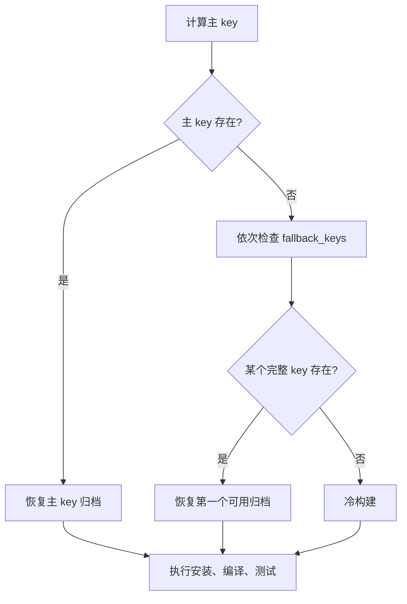

# Drone S3 Cache 接口设计与验收契约

最后核对：2026-10-30（当前工作区代码）

状态：新接口设计与验收契约；本分支已实现，真实 Runner、远端对象存储和镜像发布尚未验证。

面向使用者的完整 CLI 帮助及多场景 Drone 示例见 [使用说明](usage.zh-CN.md)。使用说明与本契约同步维护。

本文用于判断插件的功能和使用方式是否符合预期。以 GitLab CI 的缓存概念为主，参考 Drone 缓存插件及 GitHub Actions Cache，描述用户如何配置、如何命中、如何更新，以及出错时应该看到什么。

**示例使用本分支新接口；镜像标签 next 尚未发布，运行前必须替换为自行构建的镜像。** 不提供旧参数或旧对象布局的兼容入口。

## 1. 使用目标与方案选择

用户只需说明：缓存哪些目录、用什么 key 区分、未命中时尝试什么、哪些构建允许回存。无需自己编写哈希计算、S3 查找及上传下载脚本。

本文选择“文件指纹主 key + 显式维护的稳定 fallback key”。另外两种方式也有用途：

| 方式 | 适合场景 | 取舍 |
| --- | --- | --- |
| 文件指纹主 key + 稳定 fallback（本文主例） | 依赖发生变化时分开保存，同时复用旧缓存 | 需要安排一个稳定 key 的写入者 |
| 固定 key 或分支 key | Go 编译缓存等自身能识别失效内容的增量缓存 | 配置简单，但同 key 会被后续构建覆盖 |
| 按前缀搜索最近缓存 | 希望自动找到相近的历史缓存 | 需要定义列举、排序和选择规则；首版不采用 |

缓存缺失时，应能完成正常的冷构建。缓存不能替代依赖安装、编译、测试或制品交付；命中只说明恢复了缓存包，不说明所有依赖齐全，也不说明业务结果正确。

## 2. 参考项目与采用的规则

| 参考 | 已核对的行为 | 本文的选择 |
| --- | --- | --- |
| [GitLab CI 缓存](https://docs.gitlab.com/ci/caching/#use-a-fallback-cache-key) | 主 key 优先，`fallback_keys` 按顺序读取；未命中后回存到主 key | 沿用精确 key 和有序 fallback，不自动回写命中的 fallback |
| [GitLab CI policy](https://docs.gitlab.com/ci/yaml/#cachepolicy) | Runner 能安排 job 前后的缓存操作 | 不引入 `policy`；Drone 中由 `mode` 和步骤条件分别控制恢复、回存 |
| [drone-meltwater-cache](https://github.com/drone-plugins/drone-meltwater-cache/blob/master/docs/cache_key_templates.md) | key 模板可引用文件 checksum、系统及架构 | 使用结构化 `key.files` 计算指纹，提供 OS、ARCH 和环境变量占位符 |
| [GitHub Actions Cache](https://github.com/actions/cache#usage) | `restore-keys` 支持前缀匹配；主 key 命中时不会另存一份同 key 缓存 | 借鉴恢复与保存分离，但不照搬前缀匹配和不可变缓存语义 |
| [本仓库](../README.md) | 已有恢复、回存及清理的实现 | 借鉴操作划分；全新接口不保留旧参数、隐式 fallback 或旧布局读取 |

以上是选取的常见参考实现，不是按下载量排列的流行度榜单。旧的 [meltwater/drone-cache](https://github.com/meltwater/drone-cache) 已声明停止维护，本文引用其指向的 Drone 官方 fork。

GitLab 不同版本的 `files` 算法和 S3 路径可能不同。本文定义的是本插件的期望契约，不承诺与任意版本 GitLab 的哈希值或存储布局兼容。

## 3. 核心概念与配置

插件仍然分两次运行：构建前 `mode: restore`，构建成功后 `mode: rebuild`。它不接管构建命令，也不会在一次恢复调用结束后自动等待并回存。

```yaml
settings:
  mode: restore
  bucket: ci-cache
  cache:
    key:
      prefix: go1.26-linux-amd64-v1
      files:
        - go.mod
        - go.sum
    paths:
      - .cache/go
    fallback_keys:
      - go1.26-linux-amd64-v1-main
```

| 配置 | 期望含义 |
| --- | --- |
| `mode` | 保留 `restore`、`rebuild`、`flush`；一次调用只执行一种操作 |
| `bucket` | 已存在的 S3 桶，严格只填桶名，不承载对象前缀 |
| `key_from_git` | 步骤级布尔开关，默认 true；文件 key 按固定提交计算，false 时按工作区计算 |
| `commit_sha` | Git 模式的固定提交 SHA；默认取 DRONE_COMMIT_SHA，本地调用需显式提供 |
| `cache` | 一个缓存条目对象，或缓存条目对象数组；不同条目分别保存 |
| `cache[].key` | 固定字符串，或包含 `prefix`、`files` 的对象；必须显式提供 |
| `key.prefix` | 文件指纹之前的前缀；支持 OS、ARCH 和环境变量占位符 |
| `key.files` | 用于计算指纹的工作区相对文件路径或 glob；支持 `*` 和跨目录 `**` |
| `cache[].paths` | 实际归档、恢复的明确目录，不支持 glob；与计算 key 的文件列表用途不同 |
| `cache[].fallback_keys` | 有序的完整 key 字符串；默认空列表，不隐式追加默认分支缓存 |

表中的 `cache[]` 指统一处理后的条目，使用单对象时对应 `cache.key`、`cache.paths` 等字段。

### 3.1 对象、数组与环境变量传递

单个对象与包含同一个对象的单元素数组完全等价。插件读取后将对象转换为单元素数组，后续统一校验、按数组顺序处理，不维护两套缓存执行逻辑。

[Drone Docker Runner](https://github.com/drone-runners/drone-runner-docker/blob/master/engine/compiler/step.go) 将顶层 settings 转成 `PLUGIN_` 环境变量；其 [encoder](https://github.com/drone-runners/drone-runner-docker/blob/master/internal/encoder/encoder.go) 将对象、对象数组编码为 JSON。不是为每个嵌套字段生成独立变量。

```text
# 单对象
PLUGIN_CACHE={"key":"go-v1","paths":[".cache/go"]}

# 对象数组
PLUGIN_CACHE=[{"key":"go-v1","paths":[".cache/go"]}]
```

以上为变量值示意，不是可直接执行的 shell 赋值命令。也可直接提供内容为 JSON 对象或对象数组的 `PLUGIN_CACHE`。插件通过字符串入口显式 JSON 解码，不能使用 `StringSliceFlag` 代替这一步；不能把整个 JSON 按逗号拆分。嵌套在条目中的 `files`、`paths`、`fallback_keys` 保持 JSON 数组。

恢复和回存模式的输入规则：

| 输入 | 期望行为 |
| --- | --- |
| 恢复或回存时不提供 `cache` / `PLUGIN_CACHE` | 配置错误，不切换其他接口 |
| 合法对象 | 转成单元素数组后执行 |
| 合法对象数组 | 按顺序处理多个条目 |
| 空数组 `[]` | 显式禁用本次缓存操作，记录跳过，不连接 S3 |
| 空值、`null`、空对象、标量、数组内含非对象、无效 JSON | 配置错误，在任何缓存传输前失败 |
| 未知字段，包括已删除的 `policy` | 配置错误，指出字段；不静默忽略 |
| 多条目解析出相同主 key，或同一条目内/不同条目间的 `paths` 重叠 | 配置错误，在传输前失败，避免重复操作或覆盖 |

JSON 字符串本身（例如再次编码后的 `"{...}"`）不作为对象解析，不支持二次解码。所有条目先完成解析、key 计算和配置校验，再开始传输。`flush` 仍使用独立清理入口，不接受 `cache` 配置。

### 3.2 恢复与回存由步骤控制

`mode: restore` 恢复所列条目的主 key 或 fallback；`mode: rebuild` 只写入所列条目的主 key。同一份配置可以在两个步骤中复用，也可以在两个步骤中分别列出要处理的条目。

只读时只配置恢复步骤，只写时只配置回存步骤。是否在构建成功后保存，由 Drone 的步骤条件控制。首版不增加插件内的 `policy` 或失败构建保存策略。

### 3.3 key 的计算与校验

- 字符串 key 在展开占位符后使用，例如 `go1.26-linux-amd64-v1-main`。
- 文件 key 先展开 `files` 的 glob，再按规范化后的相对文件路径排序、去重，对文件路径和文件内容计算确定的 SHA-256，最终为 `<展开后的prefix>-<64位十六进制指纹>`。文件增删、改名或内容变化均改变指纹；相同文件集合下，列表顺序、重叠模式或等价模式不改变指纹，模式字符串本身不参与文件指纹。
- 文件指纹不是整个 commit 的 SHA，也不是压缩包内容校验和。仅修改不在 `files` 中的源文件，不会改变该文件 key。
- `files` 不能为空；任一明确指定的文件不存在、不可读，或任一 glob 没有匹配到文件，均为配置错误，不静默使用 `default`。这是有意区别于 [GitLab 当前缺失文件回退规则](https://docs.gitlab.com/ci/yaml/#cachekeyfiles) 的选择。
- key 不允许为空、包含 `/`、反斜杠或控制字符，也不能只由 `.` 构成；空或不合法的 prefix 同样报错。分支名作为 key 的一部分时，由流水线提供安全的分支标识，插件首版不新增 slug 转换函数。
- `paths` 不能为空，不能是工作区根目录、绝对路径或越出工作区的路径。同一条目内及不同条目间的目录均不能重叠，避免先后解压互相覆盖。

glob 默认在固定提交的文件路径列表中展开；`key_from_git: false` 时以当前工作区为根展开。`./` 前缀会规范化，因此 `./**/pom.xml` 与 `**/pom.xml` 等价。`*` 匹配单层目录中的名称字符，不跨 `/`；作为完整路径段的 `**` 匹配零层或多层目录，因此 `**/pom.xml` 同时匹配根 POM 和各子模块 POM。首版不提供排除模式、花括号展开或额外的 glob 语法。

只选择来源范围内的文件作为指纹输入，不把目录作为文件计算，不允许绝对路径、越界路径或通过符号链接越界。默认来源为指定提交，不纳入工作区修改及未提交的生成物；关闭开关后才基于实际工作区文件，且恢复和回存的文件集合及内容必须一致。两种模式均不根据 Maven 模块声明自动筛选。工作区模式的宽泛匹配可能包含生成 POM，必要时清理生成物或缩小为根 `pom.xml` 和实际模块范围。

字符串 `key`、`key.prefix`、`fallback_keys` 使用相同的有限占位符规则：`{{ .OS }}`、`{{ .ARCH }}` 分别表示插件运行平台的操作系统和 CPU 架构；`{{ .Env.VAR_NAME }}` 表示插件步骤可见的指定环境变量。变量名采用普通环境变量标识符；未知占位符、未设置或值为空的环境变量直接报错，不替换为空串。只做变量替换，不支持条件、循环、函数调用、文件读取或命令执行；`key.files` 和 `paths` 不展开模板。

先展开，再校验 key 和 prefix，最后组合文件指纹。key 中只放非敏感值，因为结果会进入对象名称和日志。恢复和回存必须提供相同的环境变量。`.OS`、`.ARCH` 不是跨平台编译的目标平台；需要区分目标平台时显式使用相应环境变量。

```yaml
environment:
  GO_VERSION: "1.26"
settings:
  mode: restore
  bucket: ci-cache
  cache:
    key:
      prefix: "gomod-go{{ .Env.GO_VERSION }}-{{ .OS }}-{{ .ARCH }}-v1"
      files: [go.mod, go.sum]
    paths: [.cache/go-mod]
    fallback_keys:
      - "gomod-go{{ .Env.GO_VERSION }}-{{ .OS }}-{{ .ARCH }}-v1-main"
```

以上为步骤配置片段；S3 连接和凭据按完整示例提供。Linux amd64、GO_VERSION=1.26 时，prefix 展开为 `gomod-go1.26-linux-amd64-v1`。

恢复与回存必须使用一致的 key 输入。默认按同一提交计算，工作区文件被修改、删除或增加生成物不影响结果；Go 主例中的 Git diff 是额外的构建输入一致性检查。关闭开关时，调用者需保持工作区中的匹配文件及内容一致，避免恢复 A 却回存 B。

#### 文件来源开关与纯 Go 实现

`key_from_git` 默认 true，通过 go-git 读取本地 Git 对象，不调用环境中的 git 命令。按固定 commit_sha 读取提交的 Tree，在仓库路径列表中匹配 glob，再读取 Blob 内容计算指纹，不执行 checkout、reset 或 clean。Git 对象可用时无需网络；采用 go-git v5.19.3，最低 Go 版本为 1.26。

新增 CLI `--key-from-git` / 环境变量 `PLUGIN_KEY_FROM_GIT`；关闭使用 `--key-from-git=false` 或 Drone settings 的 `key_from_git: false`。开关作用于本次调用中的所有文件 key，只控制 key 输入，缓存目录仍由 `paths` 指定并读写当前工作区。

固定提交由 `--commit-sha`、`PLUGIN_COMMIT_SHA` 或 `DRONE_COMMIT_SHA` 按此优先级取得。本地调用须通过 CLI 或对应环境变量提供；不能在恢复与回存时分别读取可能变化的 HEAD。仓库、提交或相关树/Blob 缺失时在传输前失败，不自动 fetch 或降级为工作区扫描。只需目标提交及其对象可用，不要求完整历史。

字符串 key、空 cache 数组和 flush 不读取 Git 对象，也不要求 commit_sha。SHA 只用于选取快照，不直接进入文件指纹；不同提交或不同来源若匹配文件路径、内容和 prefix 相同，仍得到同一 key。

如果构建前有意修改依赖描述文件并希望这些修改进入 key，显式设置 false，在恢复前完成准备，并确保回存时仍是同一批内容；默认模式不会纳入未提交修改。

普通文件参与 key 计算；Git 模式不跟随符号链接、不递归读取子模块；工作区模式也不跟随符号链接、不按 .gitignore 排除生成物。具体指纹编码见使用说明 3.2 节。

### 3.4 S3 中的对象是什么

归档固定为 gzip 压缩的 tar。用户不配置 `filename`；最终 cache key 直接构成对象名称，插件统一附加 `.tar.gz` 后缀：

```text
s3://<bucket>/<owner>/<repo>/<resolved-key>.tar.gz

s3://ci-cache/acme/service/go1.26-linux-amd64-v1-<sha256>.tar.gz
s3://ci-cache/acme/service/go1.26-linux-amd64-v1-main.tar.gz
```

S3 的对象 key 是 `<owner>/<repo>/<resolved-key>.tar.gz`，bucket 单独指定，不属于对象 key。主 key 和稳定 key 都对应完整的归档对象。文件列表不需要出现在名称里；仓库信息与最终 key 确定后，就可以直接 GET 对象，无需遍历桶或维护另外一张索引表。

`bucket`、仓库作用域、最终 key 共同决定对象位置。改变其中任何一项都可能造成未命中。key 中不填写归档扩展名；归档格式固定，不从用户名称推断。首版只在同一仓库内共享，不提供跨仓库恢复；系统、架构、工具链及信任边界需要体现在 key 或存储权限中。

## 4. 完整示例：Go 构建与 main fallback

假设默认分支名是 `main`，使用 Linux amd64、Go 1.26、`CGO_ENABLED=0`，缓存只供受信任的仓库内部 push 构建使用。实际默认分支为 `master` 时，稳定 key 和分支条件要一起替换。

为便于阅读，主例将模块下载缓存与编译缓存放在 `.cache/go` 下统一归档；有不同体积和更新频率时，可改为两个条目。`go mod download` 可能补充 `go.sum`，因此示例在下载后检查并要求依赖文件已完整提交。

```yaml
kind: pipeline
type: docker
name: build

trigger:
  event:
    - push

steps:
  - name: cache-restore
    image: docker.io/kit101z/drone-s3-cache:next
    environment: &s3-env
      CACHE_S3_ENDPOINT: https://s3.example.com
      CACHE_S3_REGION: us-east-1
      CACHE_S3_ACCESS_KEY:
        from_secret: cache_access_key
      CACHE_S3_SECRET_KEY:
        from_secret: cache_secret_key
    settings:
      mode: restore
      bucket: ci-cache
      cache: &go-cache
        - key:
            prefix: go1.26-linux-amd64-v1
            files:
              - go.mod
              - go.sum
          paths:
            - .cache/go
          fallback_keys:
            - go1.26-linux-amd64-v1-main

  - name: build
    image: golang:1.26
    environment:
      CGO_ENABLED: "0"
      GOMODCACHE: /drone/src/.cache/go/mod
      GOCACHE: /drone/src/.cache/go/build
    commands:
      - go mod download
      - git diff --exit-code -- go.mod go.sum
      - go test ./...
      - go build ./...
      - git diff --exit-code -- go.mod go.sum

  - name: cache-save-primary
    image: docker.io/kit101z/drone-s3-cache:next
    environment: *s3-env
    settings:
      mode: rebuild
      bucket: ci-cache
      cache: *go-cache
    when:
      status:
        - success

  - name: cache-save-main
    image: docker.io/kit101z/drone-s3-cache:next
    environment: *s3-env
    settings:
      mode: rebuild
      bucket: ci-cache
      cache:
        - key: go1.26-linux-amd64-v1-main
          paths:
            - .cache/go
    when:
      branch:
        - main
      status:
        - success
```

示例使用默认工作区 `/drone/src`；使用自定义 workspace 时同步调整两个 Go 环境变量。S3 入口和鉴权沿用当前插件配置；OBS、MinIO 等入口风格见 [README](../README.md)。正式使用应固定已发布镜像版本。

为什么保留单独的 `cache-save-main`：它清楚表达“main 成功构建才有权更新稳定缓存”。不新增 `update_fallback`、自动双写或隐式分支判断。用户不需要稳定 fallback 时，删除该步骤及 `fallback_keys` 即可。

## 5. 命中、更新与故障流程

### 5.1 恢复顺序



每个条目最多恢复一份归档，不合并主 key 和多个 fallback。这里只做完整 key 匹配：配置 `go-main` 不会自动找到 `go-main-abc2`。

### 5.2 go.mod 更新后，main 何时更新

下表用 `abc1`、`abc2` 缩写实际 64 位文件指纹，省略共同前缀。

| 时点 | 恢复 | 成功后的写入 | 稳定 main 的状态 |
| --- | --- | --- | --- |
| main 首次构建，指纹 abc1 | 全部未命中，冷构建 | 写 abc1，再写 main | main 含本次构建产生的缓存 |
| feature 修改依赖，指纹 abc2 | abc2 未命中，读取 main | 只写 abc2 | main 保持原样，feature 无权更新 |
| main 合入相同依赖，指纹 abc2 | 若 abc2 已可用则直接读取，否则回退 main | 写 abc2，再覆盖 main | main 得到 main 构建后的缓存 |
| main 后续仅修改源码 | 文件 key 可能仍为 abc2 | 同样覆盖 abc2 和 main | 即使主 key 命中，main 仍会刷新 |
| 任一构建失败 | 正常恢复或冷构建 | 不执行两个保存步骤 | 不以失败构建覆盖稳定缓存 |

所以，**fallback 不会自动更新；稳定 key 由显式使用该 key 的写入步骤更新。** main 长期没有成功构建时，它自然会落后；依赖或源码变化并不保证旧缓存完全可用，安装和构建工具仍需检查并补齐。

### 5.3 同 key、双写和并发

- 主 key 与稳定 key 均允许覆盖。同样的依赖文件不代表编译缓存永远不变，不能因精确命中就默认跳过回存。
- 两个保存步骤是两次对象写入，不是事务。主 key 已成功而 main 写入失败时，主 key 保留，main 仍为旧版，日志必须分别报告结果。
- 首版允许两次归档和上传；这有明确的带宽和耗时成本。暂不要求服务端复制、指针对象或归档去重。
- 相同 key 并发写入采用最后成功完成的写入；不合并两个缓存包，也不保证较新 commit 一定覆盖较旧 commit。
- 稳定 main 表示“最近一次成功上传的 main 缓存”，不是严格按 commit 排序的最新状态。需要更强顺序保证时，由 CI 串行运行该生产者；历史提交重跑也可能覆盖它。

### 5.4 未命中和错误应有区别

| 情况 | 期望结果 |
| --- | --- |
| 主 key 对象不存在（NoSuchKey/NotFound） | 记录 miss，继续下一个 fallback |
| 所有 key 均不存在 | 记录 cold build，恢复步骤成功退出 |
| 下载时网络超时、权限不足、NoSuchBucket、存储不可用 | 记录具体错误及候选 key，终止该条目的远端尝试，警告后冷构建；不能伪装成普通 miss |
| 归档损坏、校验或解压失败 | 不将半解压内容混入后续构建；隔离解压，放弃该条目并警告后冷构建 |
| key 文件不存在、路径越界、配置冲突、SDK 配置或客户端初始化失败 | 配置错误，步骤失败；不能借缓存可选而吞掉配置错误 |
| 回存目录部分不存在 | 警告并跳过缺失目录；有其他有效内容时继续归档 |
| 回存目录均不存在或没有可归档内容 | 跳过上传，不用空归档覆盖已有缓存 |
| 归档或上传失败 | 回存步骤失败；上传失败不能暴露可读取的半个对象，旧对象应保持可读 |

只有客户端初始化成功后的下载、归档和恢复故障才允许警告后继续构建；客户端初始化失败直接使步骤失败。回存错误使步骤失败，延续现有插件的主要取舍。多条目恢复时，远端或归档故障只放弃该条目，继续处理其他条目；配置错误直接失败。回存遇到首个错误就失败，此前已经写入的条目不回滚。

成功恢复时整体替换归档中存在的声明缓存目录，不合并旧文件；归档缺少的声明目录保持原状。发布失败会尝试回滚，但不保证多个目录原子替换或进程强制终止后的恢复；暂存与备份占用工作区磁盘。

如果项目允许缓存回存失败而不影响交付，可在 Drone 的回存步骤显式设置 `failure: ignore`。这属于流水线选择，不把所有上传错误默认吞掉。

## 6. 缓存哪些目录，怎样选 key

以下是本文建议，不是要求插件识别语言或自动猜目录。

| 场景 | 建议缓存内容 | 建议 key 输入 | 构建仍需执行 |
| --- | --- | --- | --- |
| Go 模块下载 | 显式设置到工作区的 `GOMODCACHE` | `go.mod`、`go.sum`；工作区项目还需纳入相应清单 | `go mod download` 或正常 Go 构建 |
| Go 编译 | 显式设置到工作区的 `GOCACHE` | 工具链、OS、架构、CGO 环境；可用稳定 key 持续积累 | `go build`、`go test` |
| npm | `.npm` 等下载缓存 | Node/npm 环境前缀 + `package-lock.json` | `npm ci --cache .npm` |
| Maven | 工作区内的本地 repository，如 `.m2/repository` | JDK/Maven 环境前缀 + `./**/pom.xml`，或缩小到实际模块 POM 范围 | 正常 Maven 构建及依赖更新策略 |
| BuildKit | 显式导出到工作区的构建缓存 | 平台、构建配置及应用作用域 | 实际的缓存导入、镜像构建与导出 |

Go 模块缓存用于复用下载的模块；可通过 `GOMODCACHE` 指定位置，不能把整个 GOPATH 都视作模块缓存。[Go 官方说明](https://go.dev/ref/mod#module-cache)

npm 主例缓存下载内容，不缓存 `node_modules`。`npm ci` 会删除现有 `node_modules`，恢复后仍应安装依赖。[npm ci 官方说明](https://docs.npmjs.com/cli/v11/commands/npm-ci/)

多模块 Maven 项目可用 `key.files: ["./**/pom.xml"]` 覆盖根及子模块的 POM；这些文件仅计算 key，实际上传的仍是 `paths` 中的 `.m2/repository`。默认按固定提交匹配，生成的 POM 不参与；只有关闭 key_from_git 后，才需要通过 clean 或缩小匹配范围防止工作区生成物污染。SNAPSHOT 的刷新仍由 Maven 策略负责。

BuildKit 内部缓存与工作区目录是不同层。插件只能归档可见目录，不能自动访问 DinD/BuildKit 内部数据；外部构建缓存需要明确导入和导出，也不能声称普通导出自动覆盖所有 cache mounts。[Docker 官方说明](https://docs.docker.com/build/cache/backends/)

不要把 `.git`、凭据文件或工作区整体放进缓存。用于发布的二进制、镜像和前后步骤必须传递的构建产物，应使用制品机制。

## 7. 权限、清理与可观察结果

### 7.1 谁可以读写

主例假定内部 push 的代码和凭据使用者可信。PR、外部 fork 及其他不可信代码不应获得缓存写凭据；是否能只读，也取决于缓存是否包含私有依赖和敏感内容。

只配置 `mode: restore` 不能替代权限隔离。需要只读时配合 S3 只读凭据，限定桶和仓库前缀。需要隔离的信任域使用不同权限和命名空间，不依赖“key 很难猜”。归档恢复不得通过路径或链接逃逸出声明的目标目录。支持同一缓存目录内可解析的相对符号链接；拒绝绝对、越界或悬空链接、硬链接归档条目及特殊文件。

### 7.2 历史 hash 缓存何时删除

abc1、abc2 等旧对象不会因新 key 出现而自动删除。建议按对象最后写入时间清理，例如保留 30 天；可使用限定前缀的 S3 生命周期规则或独立 `flush` 维护任务，不在每次构建前扫描全桶。

`flush_path` 默认是 `<owner>/<repo>/`，可显式缩小到该仓库下的前缀；`flush_age` 默认 30，必须为正整数。清理必须保留仓库路径边界，不允许扩大到其他仓库或整个桶。flush_path 按字符串前缀匹配、不自动补斜杠，删除范围包含该前缀下所有过期对象，不按 .tar.gz 后缀过滤。

清理不是按最近命中时间计算。长期只读的热缓存也可能过期，过期后允许冷构建重建；稳定 main 没有成功刷新时同样可能过期。清理范围必须严格限定目标仓库前缀，不能删到前缀相似的其他仓库。

手动失效优先修改 key 中的版本，例如 `v1` 改为 `v2`；同时修改主 key 的 prefix、fallback key 及稳定 key 写入配置。这样旧缓存保留至正常清理，不需要先删除整个桶。

### 7.3 用户应从日志看到什么

每个条目至少记录：计算后的主 key、命中的 key、精确命中或 fallback 命中、全部未命中或故障、下载与上传字节数、传输及归档/解压耗时、实际回存对象，以及跳过原因。密钥和带签名的 URL 不能出现在日志中。

```text
restore key=go1.26-linux-amd64-v1-abc2 result=miss
restore key=go1.26-linux-amd64-v1-main result=fallback-hit
rebuild key=go1.26-linux-amd64-v1-abc2 result=uploaded
rebuild key=go1.26-linux-amd64-v1-main result=uploaded
```

以上 hash 为缩写，日志格式为示意。插件记录自身耗时；是否提速还需比较整个 CI 的恢复、构建、归档和上传总耗时，不能仅凭命中或 Go 编译变快得出收益结论。

## 8. 全新接口边界

不保留 `root`、`filename`、旧 `mount`、`path`、`fallback_path`、布尔操作开关或无缓存用途的继承参数；也不增加 `policy`。桶名只由 `bucket` 提供，endpoint 只表示服务入口，不从中解析桶名或区域。

恢复和回存必须明确提供 `cache`，单对象与数组共用处理逻辑；只有显式 `[]` 才表示跳过。fallback 只按配置读取，不做隐式默认分支回退。多个条目使用当前步骤的同一个 mode。

不读取、迁移或自动删除旧布局对象，初次使用可能冷构建。当前实现可作为 S3 传输逻辑的参考，新解析、模板、隔离解压、空包保护和清理边界按本契约提供本地测试；不能据此推断实际部署和镜像发布已完成。

## 9. 评审与验收场景

| 编号 | 场景 | 应观察到的结果 |
| --- | --- | --- |
| A1 | 新仓库首次构建 | 全部未命中也能完成构建；成功后生成主 key |
| A2 | 相同文件和环境再次构建 | 主 key 精确命中，不读 fallback；允许成功后覆盖同 key |
| A3 | 只修改普通源码 | 文件 key 不变；编译工具检查并重建失效内容 |
| A4 | 修改 go.mod 或 go.sum | 生成新 key；新 key 未命中后读取稳定 main |
| A5 | feature 成功构建 | 可写自己的主 key，不触发 main 保存步骤 |
| A6 | main 成功构建 | 写主 key 并显式刷新 main；精确命中也刷新 |
| A7 | 构建步骤失败 | 保存步骤不运行，不污染主 key 和稳定 main |
| A8 | 第一个 fallback 不存在、第二个存在 | 按顺序命中第二个，不混合两份内容 |
| A9 | 分别调用 `mode: restore`、`mode: rebuild` | 前者不上传，后者不下载；只有显式配置的步骤执行对应操作 |
| A10 | 指定 key 文件缺失、路径越界或提供已移除参数 | 配置失败，能定位字段与原因 |
| A11 | 403、网络超时、损坏归档 | 区分错误与 miss；不留下半恢复内容，按约定冷构建 |
| A12 | 所有回存目录为空或缺失 | 跳过，不用空包覆盖已存在对象 |
| A13 | 主 key 成功上传，main 上传失败 | 分别报告，保留已成功对象；不宣称双写成功 |
| A14 | 上传中断、打包失败 | 步骤失败，旧对象仍可用，不读取到半个新对象 |
| A15 | 切换架构、工具链或缓存版本 | 使用不同 key，不误复用不兼容缓存 |
| A16 | 并发写入、历史 main 重跑 | 行为符合最后成功写入规则，不宣称按 commit 自动选新 |
| A17 | 过期清理 | 只影响目标仓库范围；被清理后仍可冷构建 |
| A18 | 真实 Drone 传参及跨步骤共享目录 | 单对象和对象数组均正确传入；构建实际使用恢复目录，而非仅产生空缓存 |
| A19 | 同一个条目分别用对象、单元素数组提供 | 计算相同 key，执行行为和结果相同 |
| A20 | `cache: []` 与未提供 cache | 前者明确跳过，后者配置失败，不混淆两者 |
| A21 | 无效 JSON、null、非对象元素、未知字段或重复主 key | 在任何传输前失败，并定位错误条目或字段 |
| A22 | 使用 OS、ARCH、Env 占位符 | 主 key、prefix、fallback 一致展开；未知或缺失变量在传输前失败 |
| A23 | 检查对象名称和桶名 | bucket 只填桶名；对象为 owner/repo/最终key.tar.gz，没有额外归档名层级 |
| A24 | `./**/pom.xml` 匹配根和多层子模块 | 根 POM 与各级模块 POM 都进入指纹；`./` 不影响结果 |
| A25 | 调整 files 顺序、使用重叠或等价模式 | 相同文件集合得到相同指纹，文件不重复计算 |
| A26 | 提交中的模块 POM 变化；或工作区模式中的模块 POM 变化 | 所选来源的文件集合或内容变化后生成新 key |
| A27 | 任一模式无匹配、文件不可读或路径越界 | 传输前配置失败，不使用默认 key |
| A28 | 将通配符配置在 paths 而非 key.files | 配置失败；paths 只接受明确的缓存目录 |
| A29 | 不设置 key_from_git，构建前后修改、删除工作区 POM 或生成新 POM | 按同一 commit_sha 的提交内容计算，文件 key 不变，不依赖 clean |
| A30 | key_from_git=false，使用未提交或预先生成的 POM | 按实际工作区文件计算，不依赖 Git 对象；恢复与回存输入须一致 |
| A31 | Git 模式缺少固定 SHA、仓库或目标对象 | 传输前失败，不自动联网或降级 |
| A32 | 固定字符串 key、空数组或 flush，环境没有 Git 元数据 | 不读取 Git 对象、不要求 commit_sha；按各操作规则处理 |
| A33 | 不同提交但匹配路径、内容及 prefix 相同 | 计算相同 key，commit SHA 本身不进入指纹 |

本接口采用结构化 key 配置、只做完整 key 的 fallback、稳定 key 显式维护、同 key 可覆盖，以及恢复故障宽容而回存错误可见的规则。首版范围不包含前缀搜索、跨仓库共享、分布式锁、自动识别语言、远程缓存合并或 BuildKit 内部缓存管理。

## 10. 本地验证状态

以下结果来自本会话上一轮实现验证，本次仅复核代码与文档并重新运行本地测试及 CLI 帮助检查；未重复容器或远端验收。

已通过 race 测试、lint、三平台二进制构建和 Linux amd64/arm64 镜像构建。本地 MinIO 使用 scratch 镜像实跑 20 MiB 分片上传、按 Git 快照精确恢复、提交变化后 fallback、工作区模式、失败上传保护旧对象及零残留分片；空目录回存与近期对象清理保护通过。测试未连接远端 OBS/S3，也未执行真实 Drone pipeline 或发布镜像。
